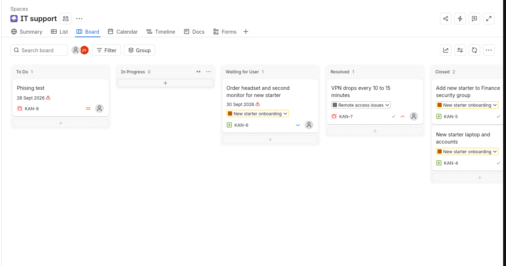
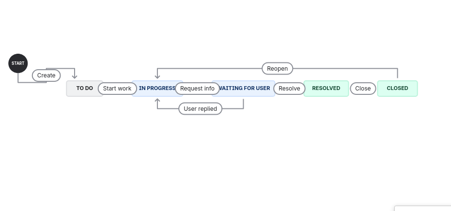
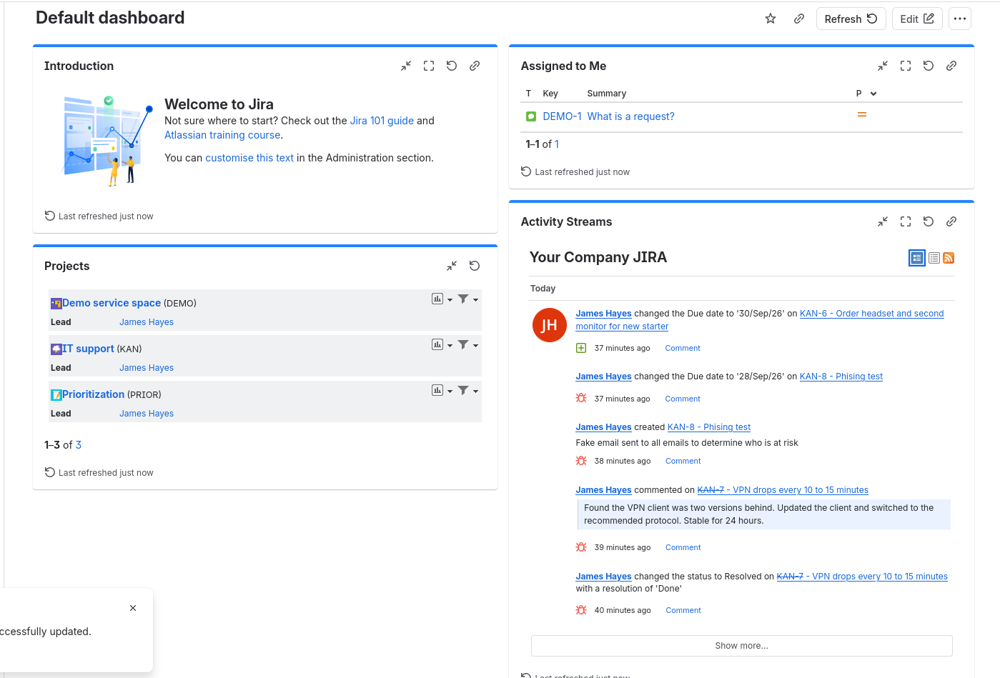
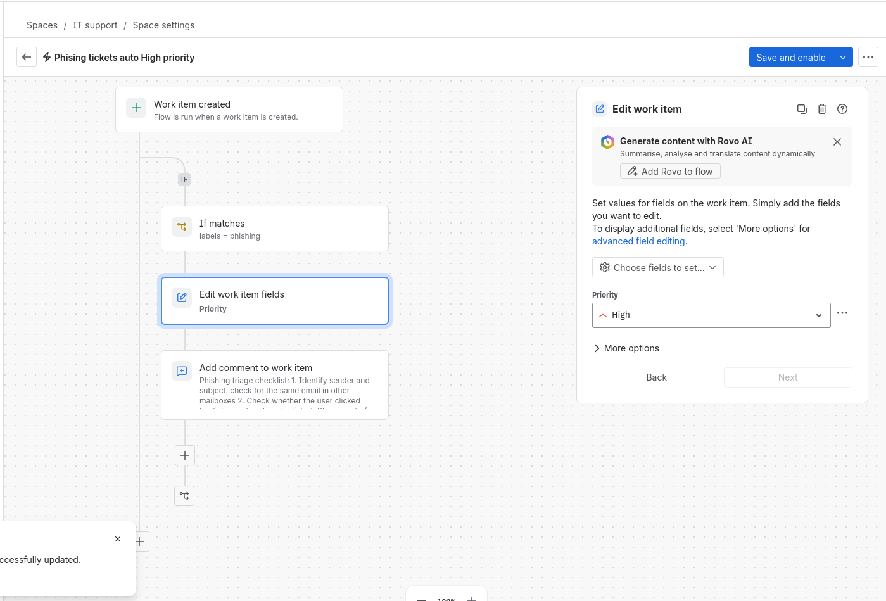

# Jira Service Desk Project

A hands on project demonstrating core Jira skills through a simulated IT support desk. It covers ticket handling, workflows, reporting.

## What I built

- **Kanban board** with a support workflow: To Do → In Progress → Waiting for User → Resolved → Closed
- **tickets** covering service requests, faults and security incidents, each with a clear description, priority, labels and resolution
- **Epics** grouping related work (new starter onboarding, phishing campaign, remote access issues)
- **Dashboard** showing open tickets by priority, created vs resolved, and a high-priority list
- **Automation rule**: set any phising work items created to be set at High priority
## Screenshots

| | |
|---|---|
|  |  |
|  |  |

## Skills demonstrated

- Creating and prioritising tickets with clear, searchable descriptions
- Triage and escalation of security-related incidents
- Customising workflows, issue types and labels
- Searching and reporting with JQL and dashboards
- Using automation to reduce repetitive work

## What I'd improve next

- Use Jira Service Management for a customer request portal and SLA timers
- Build a knowledge base with articles for the most common issues
- Add more automation (auto-assign by label, SLA breach alerts)
- Track recurring problems with Problem tickets
